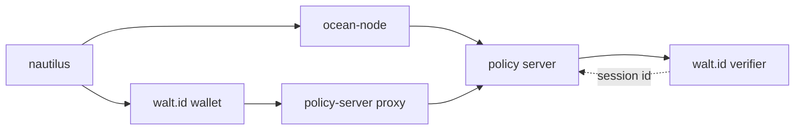
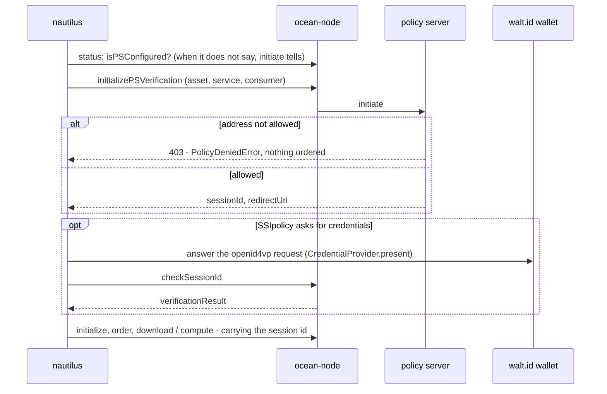

# Credential-gated assets

Some assets require you to prove something about yourself before you can access them — that
you hold a particular verifiable credential, issued by someone the publisher trusts. This
guide covers both sides: consuming a gated asset, and publishing one.

This is new in nautilus v2. It did not exist in v1, because the stack it depends on did not.

## How the pieces fit

Four components are involved, and they form a deliberate loop so that the node observes
every credential exchange:



The loop is deliberate: every credential exchange passes through the node, so it observes the
result rather than taking the client's word for it.

nautilus only ever talks to two of them directly: **ocean-node**, through its
`initializePSVerification` and policy-server passthrough endpoints, and the **walt.id
wallet**, to actually present credentials. Everything else happens between the services.

What nautilus needs out of the exchange is one thing: a **policy-server session id**. On a
node with a policy server, ocean-node checks it on every download and compute job of an asset
that has `credentials`, whether the asset is gated by addresses or by an `SSIpolicy`.

## Consuming a gated asset

nautilus opens the policy-server session itself, inside `access`, `compute` and
`freeCompute`. Nothing changes at the call site.

**Gated by addresses only**, an asset needs no wallet and no configuration: the session the
policy server opens is all the node checks.

```ts twoslash
import { JsonRpcProvider, Wallet } from 'ethers'
import { Nautilus } from '@deltadao/nautilus'

const signer = new Wallet('0x...', new JsonRpcProvider('https://rpc.dev.pontus-x.eu'))
const config = { oceanNodeUri: 'https://node.example.org' }
// ---cut---
const nautilus = await Nautilus.create(signer, { config })

// The session is opened before the order, and carried into the download URL.
const { url } = await nautilus.access({ assetDid: 'did:ope:1234abcd...' })
```

**Gated by an `SSIpolicy`**, an asset asks for a verifiable presentation. Configure a
credential provider once; it answers the presentation request from your wallet.

```ts twoslash
import { JsonRpcProvider, Wallet } from 'ethers'
import { Nautilus, WaltIdCredentialProvider } from '@deltadao/nautilus'

const signer = new Wallet('0x...', new JsonRpcProvider('https://rpc.dev.pontus-x.eu'))
const config = { oceanNodeUri: 'https://node.example.org' }

// The provider needs a node client, so build the instance in two steps.
const bootstrap = await Nautilus.create(signer, { config })

const nautilus = await Nautilus.create(signer, {
  config,
  credentials: new WaltIdCredentialProvider(bootstrap.getNodeClient(), { // [!code focus]
    walletApi: 'https://wallet.example.org' // [!code focus]
  }) // [!code focus]
})

// Unchanged — the credential exchange happens inside.
const { url } = await nautilus.access({ assetDid: 'did:ope:1234abcd...' })
```

Without a provider, an asset that asks for a presentation is refused with a clear error
before anything is signed or ordered.

### What happens, in order



1. nautilus reads `isPSConfigured` from the node's status. A node without a policy server
   checks credentials itself, and needs no session: nautilus opens none. Upstream
   ocean-node 4.2.0 does not report `isPSConfigured`; there nautilus learns it from
   `initiate`, which such a node answers with a 404 and no body.
2. If neither the asset nor the service has `credentials` (`{}` counts as having them, as
   the node checks it), the node checks nothing, and no session is opened either.
3. Otherwise nautilus starts a verification. The policy server checks your address against
   the asset's allow list and opens a session bound to (consumer, asset, service), or refuses
   with a `PolicyDeniedError` that carries its reason.
4. If the asset or service carries an `SSIpolicy` that asks for credentials, the credential
   provider answers the openid4vp request from your wallet, and nautilus checks with the
   policy server (`checkSessionId`) that the verifier accepted it. A presentation that was not
   accepted is a `PolicyDeniedError` naming the failed policies.
5. The session id is carried into the download URL, or into `initializeCompute` and
   `computeStart`: one session per compute input, the algorithm included.

:::info
The session is always opened **before** anything is ordered. A policy you cannot satisfy
costs you nothing, and a refusal is never cached: the next call asks again.
:::

### Handling a refusal

```ts twoslash
import { JsonRpcProvider, Wallet } from 'ethers'
import { Nautilus, PolicyDeniedError } from '@deltadao/nautilus'
const signer = new Wallet('0x1234', new JsonRpcProvider('https://rpc.dev.pontus-x.eu'))
const nautilus = await Nautilus.create(signer, {
  config: { oceanNodeUri: 'https://node.example.org' }
})
// ---cut---
try {
  await nautilus.access({ assetDid: 'did:ope:1234abcd...' })
} catch (error) {
  if (error instanceof PolicyDeniedError) // [!code focus]
    console.log(error.code, error.reason) // [!code focus]
  // @log: 403 'Access denied: Address not allowed at asset level.'
  else throw error
}
```

`code` is the policy server's status for the refusal, and `undefined` when the verifier did
not accept a presentation; `reason` then names the failed policies
(`revoked-status-list: credential is revoked`), and `policyResults` lists each policy's name,
outcome and error, never the presentation itself. Only the policy server's own refusal is a
`PolicyDeniedError`. Everything else is an `OceanNodeError` with the status: the node
rejecting the nonce or signature (401), not having indexed the asset (404), not reaching its
policy server (400), a network error, a timeout or a 5xx.

If the wallet holds nothing that matches, the provider's error carries the credentials you are
*missing*, rather than just reporting no match.

### Refused before presenting

Before it presents anything, `WaltIdCredentialProvider` checks the one policy whose outcome it
can decide from what it holds: `holder-binding`. When the service requires it and a selected
credential's JWT has no `sub`, or a `sub` (up to a `#`) that is not the DID you present as, the
verifier would refuse the presentation, so the provider throws a
`CredentialRejectedLocallyError` instead, with nothing presented, ordered or paid:

```ts twoslash
import { JsonRpcProvider, Wallet } from 'ethers'
import { CredentialRejectedLocallyError, Nautilus } from '@deltadao/nautilus'
const signer = new Wallet('0x1234', new JsonRpcProvider('https://rpc.dev.pontus-x.eu'))
const nautilus = await Nautilus.create(signer, {
  config: { oceanNodeUri: 'https://node.example.org' }
})
// ---cut---
try {
  await nautilus.access({ assetDid: 'did:ope:1234abcd...' })
} catch (error) {
  if (error instanceof CredentialRejectedLocallyError) // [!code focus]
    console.log(error.policy, error.reason, error.credentialType) // [!code focus]
  // @log: holder-binding no-sub gx:LegalPerson
  else throw error
}
```

`reason` is `'no-sub'` or `'sub-mismatch'` (a `sub` that is another DID, empty, or not a
string), and the message says what to do: ask the publisher to drop `holder-binding`, which
applies to every credential in the presentation, or present a credential issued to your DID.
Credentials the provider cannot decode (SD-JWT, JSON-LD, anything but a plain JWT) are not
judged: they are presented, and a `debug` event `identity.preflight.skipped` says so. Pass
`preflight: false` to the provider for a verifier whose rule differs from walt.id's. Every
other refusal still comes from the verifier, as above. This check helps honest consumers; it
is no access control, which stays with the verifier and the address allow list.

### What the wallet trusts

For a download, the presentation request comes from the node in the service's
`serviceEndpoint`, which the publisher chose. So `WaltIdCredentialProvider` checks it before
the wallet sees it:

- the request must be an `openid4vp://` URL, and its `request_uri`, `response_uri` and
  `presentation_definition_uri` must be `https://`, or `http://` on a loopback host
  (`allowInsecureTransport: true` accepts plain `http://` elsewhere, e.g. a private
  network). Other schemes, link-local hosts and cloud metadata addresses are always refused;
- every input descriptor of the presentation definition must ask for a credential type the
  asset's or service's `request_credentials` name, and only wallet credentials of those types
  are presented, whatever the wallet matched or `onSelectCredentials` returned;
- the wallet signer must be the consumer: a provider built with another signer refuses to
  present its credentials for a session bound to your address.

### Choosing credentials and DIDs

By default the provider is **headless**: it presents every matching credential and uses the
wallet's first DID. That is what makes it usable from a script or CI with no interaction.

For an interactive application, supply the selection callbacks instead:

```ts twoslash
import { JsonRpcProvider, Wallet } from 'ethers'
import { Nautilus, WaltIdCredentialProvider } from '@deltadao/nautilus'
const signer = new Wallet('0x1234', new JsonRpcProvider('https://rpc.dev.pontus-x.eu'))
const config = { oceanNodeUri: 'https://node.example.org' }
const bootstrap = await Nautilus.create(signer, { config })
// ---cut---
const credentials = new WaltIdCredentialProvider(bootstrap.getNodeClient(), {
  walletApi: 'https://wallet.example.org',

  // Ask the user which of the matching credentials to present.
  onSelectCredentials: async (matches) => { // [!code focus]
    return matches.filter((candidate) => candidate.id === 'a-chosen-credential') // [!code focus]
  }, // [!code focus]

  // Ask the user which holder DID to present as.
  onSelectDid: async (dids) => dids[0].did // [!code focus]
})
```

You can also pin a wallet and DID outright with `walletId` and `did`.

### Sessions

nautilus caches each verified session per (node, asset, service, consumer): the policy
server binds a session id to `sha256(consumerAddress:documentId:serviceId)` and the node that
opened it, so a session for another account or node would be refused. Pass `sessionStore` to
`Nautilus.create` to keep address-only sessions somewhere else than in memory.

:::warning
Session ids are credentials. The node accepts one for the download or compute job, and the id
of a presented session lets anyone read the verifier's record through the node's passthrough
(`checkSessionId` is not signed), the presentation (`vp_token`) included, until the verifier
forgets it. So presented sessions stay in memory even with a `sessionStore`, unless you set
`persistPresentedSessions: true` for a store no one else can read. Keep session ids out of
logs and shared URLs.
:::

A cached session is reused for at most `sessionTtlMs` (2 minutes by default) from when it was
opened, and one that needed a presentation is checked with the policy server again before it
is reused: walt.id's verifier forgets a session after 5 minutes, or when it restarts. A stale
session is opened again before anything is ordered, so a store that outlives the policy
server costs one more exchange, not a refused order.

:::warning
Never invent a session id. The policy server derives it from
`sha256(consumerAddress:documentId:serviceId)` plus a random half, and rejects any session
whose context does not match the request. The address is hashed as the node forwards it: the
address it authenticated, which for a Signer is the request's (nautilus sends
`signer.getAddress()` to `initiate` and to the download or compute call) and for a JWT the
address stored with the token, whatever the request says. nautilus keys its cache on that
address (`OceanNodeClient.policySessionAddress`).
:::

## Publishing a gated asset

Declare which credentials you require, who must have issued them, and the checks they must
pass. This is the set to start from: it works through nautilus, ocean-node, the policy server
and the walt.id verifier as they are deployed today.

```ts twoslash
import { AssetBuilder, CredentialListTypes } from '@deltadao/nautilus'

const assetBuilder = new AssetBuilder()
// ---cut---
assetBuilder
  // The gate that holds: list addresses explicitly, never '*' (see the limitation below).
  .addCredentialAddresses(CredentialListTypes.ALLOW, ['0x0DB823218e337a...'])
  .addRequestCredentials(CredentialListTypes.ALLOW, [ // [!code focus]
    { // [!code focus]
      type: 'gx:LegalPerson', // [!code focus]
      format: 'jwt_vc_json', // [!code focus]
      policies: [ // [!code focus]
        // Issuer trust, per credential: only credentials from these issuers count. // [!code focus]
        { policy: 'allowed-issuer', args: ['did:web:delta-dao.com'] } // [!code focus]
      ] // [!code focus]
    } // [!code focus]
  ]) // [!code focus]
  .setVcPolicies(CredentialListTypes.ALLOW, [ // [!code focus]
    'signature', // [!code focus]
    'not-before', // [!code focus]
    'revoked-status-list' // [!code focus]
  ]) // [!code focus]
  .setVpPolicies(CredentialListTypes.ALLOW, [ // [!code focus]
    { policy: 'signature' }, // [!code focus]
    { policy: 'minimum-credentials', args: '1' } // [!code focus]
  ]) // [!code focus]
```

**VC policies** check each presented credential; **VP policies** check the presentation as a
whole. nautilus's `DEFAULT_VC_POLICIES` are `signature`, `not-before` and
`revoked-status-list`, the values the policy server ships; a deployment can run more, because
the policy server adds the `DEFAULT_VC_POLICIES` and `DEFAULT_VP_POLICIES` of its environment
to every session, which nautilus cannot see. Valid names can be listed from the verifier's
`/openid4vc/policy-list` endpoint.

VC policies are names, while every VP policy is an object, `{ policy }` or
`{ policy, args }` with `args` as a string, as the enterprise market writes them: an asset
whose list mixed names and objects was published but not indexed by ocean-node 4.2.x. The policy server parses `args` as JSON when it can, so `'1'` reaches the
verifier as the number `1`; pass structured arguments through `JSON.stringify`.
`minimum-credentials` needs its argument: walt.id reads it as a number, and a bare
`{ policy: 'minimum-credentials' }` fails in the verifier for every presentation.

**Check the presentation's own signature** with `{ policy: 'signature' }` among the VP
policies. walt.id runs only the VP policies the session lists, so without it nothing checks
that the presentation was signed by the DID it names, unless the policy server's operator adds
it through `DEFAULT_VP_POLICIES`, which nautilus cannot see. Listed on the asset, the check
holds whatever that setting is; when the policy server adds it too, it simply runs twice. It
does not bind the credential to the presenter, which is `holder-binding`'s job, and it does not
stop a presentation replayed from an earlier session: the verifier accepts it.

**Put policies that take arguments on the credential.** The policy server keeps only the
*name* of an asset- or service-level VC policy and drops its arguments. `allowed-issuer`
without its list of issuers throws "Invalid argument" in walt.id, which fails the
presentation and so **denies every consumer**. Per-credential `policies` (the `policies` of a
`request_credentials` entry) and VP policies keep their arguments, so issuer trust and other
argument-bearing checks such as walt.id's `schema` go on the credential, as above.

:::warning[Leave out `holder-binding` for Gaia-X and other `vc+jwt` credentials]
`holder-binding` checks that the presenter is the subject of every credential in the
presentation. What it gives and what it costs:

- It binds a credential to its presenter **only** when the credential JWT's `sub` is the
  presenter's DID, and only when the presentation's signature is verified as well (the VP
  policy `signature`, part of the set above): it compares `sub` with the DID the presentation
  claims, which proves nothing unless that presentation's signature is checked. walt.id reads
  `sub` and nothing else.
- It fails, with a `NullPointerException` in the verifier, for credentials without `sub`
  (common for VCDM 2.0 `vc+jwt`) and URL-subject credentials such as the Gaia-X
  `gx:LegalPerson` credential. An asset that requires it refuses every holder of such a
  credential.
- Without it, a copied credential JWT can be presented from any wallet: the credential is a
  bearer credential. Assets that need access bound to an account must rely on the address
  allow list, which is the gate that binds access to the consumer's Ethereum account.

Require it only when every credential the asset accepts carries the holder's DID in `sub`.
:::

:::warning[No `presentation-definition` with `jwt_vc_json`, for now]
The policy server does not forward a presentation definition of the asset's own: walt.id
generates one from `request_credentials`, and for `jwt_vc_json` it matches the credential's
type at `$.vc.type`. A VCDM 2.0 `vc+jwt` credential such as `gx:LegalPerson` carries its
`type` at the top level and has no `vc` claim, so nothing matches and
`presentation-definition` refuses it. Only VCDM 1.1 credentials (`vc`-wrapped) pass. Leave it
out of `vp_policies` until the policy server forwards a definition that matches VCDM 2.0
credentials.
:::

### Choosing VP and VC policies

What each policy checks, and where it belongs, with walt.id and the policy server as deployed:

| Policy | Where | Checks | In the set above |
| --- | --- | --- | --- |
| `signature` | VC policies | Each credential's signature, by its issuer's key | Yes |
| `not-before` | VC policies | Each credential is past its start date | Yes |
| `revoked-status-list` | VC policies | Each credential with a status list is not revoked | Yes |
| `expired` | VC policies | Each credential is before its expiry date | Optional |
| `allowed-issuer` | Per credential, with `args: ['did:…']` | The credential's issuer is one of these | Yes |
| `schema` | Per credential, with a JSON Schema object as `args` | The credential's content | When you need it |
| `signature` | VP policies | The presentation is signed by the DID it names | Yes |
| `minimum-credentials` | VP policies, with `args: '1'` | At least that many credentials, of any type | Yes |
| `holder-binding` | VP policies | Every credential's JWT `sub` is the presenter's DID | No: refuses `vc+jwt` credentials without `sub` |
| `presentation-definition` | VP policies | The credentials match walt.id's generated definition | No: refuses VCDM 2.0 credentials |

Policies that take arguments go on the credential or among the VP policies; at asset or
service level, VC policies are names only.

**`build()` checks this for you.** [`AssetBuilder.build()`](/docs/api/assetbuilder/build)
reads the SSI policies of the asset and of each service, merged as the policy server merges
them, and:

| Finding | What happens |
| --- | --- |
| A service whose merged view holds an `SSIpolicy` entry but requests no credential | Throws an `SsiPolicyError`: the policy server refuses every consumer of that service ("SSIpolicy was found, but failed to fetch request credentials"). See [per-service gating](#per-service-gating) |
| A VC policy at asset or service level that needs arguments (`allowed-issuer`, `schema`, `webhook`, `dynamic`, `credential-status`) | Throws an `SsiPolicyError`: the policy server keeps only the name, so the check fails every presentation. Put it on the credential |
| Any other VC policy at asset or service level with arguments | Throws an `SsiPolicyError`: the check silently runs without them. Drop the arguments and keep the name |
| `minimum-credentials` or `maximum-credentials` without an integer `args`; `vp_required_credentials` without `args` of the form `{ required: [...] }` | Throws an `SsiPolicyError`: walt.id fails it for every presentation |
| A per-credential `allowed-issuer` that names no issuer (no `args`, `[]`, `'*'`) | Throws an `SsiPolicyError`: walt.id refuses every credential (`'*'` is not a wildcard) |
| No VC `signature` in the merged view | Warns: `identity.policy.no_vc_signature` (a credential naming a trusted issuer but signed by anyone passes `allowed-issuer`) |
| No VP `signature` in the merged view | Warns: `identity.policy.no_vp_signature` |
| No `minimum-credentials` of at least 1 in the merged view | Warns: `identity.policy.no_minimum_credentials` (a presentation holding no credential passes) |
| `'*'` in the address allow list of a credential-gated service, as the policy server reads it | Warns: `identity.policy.wildcard_allow` (no gate against a hand-built presentation; see the [limitation below](#known-limitation-credentials-of-another-type)) |
| `holder-binding` | Warns: `identity.policy.holder_binding` |
| `presentation-definition` with a `jwt_vc_json` or `jwt_vc` credential | Warns: `identity.policy.presentation_definition_vc_jwt` |
| A requested credential type whose effective per-credential policies have no `allowed-issuer` | Warns: `identity.policy.no_issuer_trust` (a self-issued credential of that type is accepted) |
| A type requested twice with different per-credential policies | Warns: `identity.policy.credential_policies_replaced`: walt.id keeps only the last non-empty list per type, after the policy server drops repeats of an identical request (the first one keeps its position), so the other lists never run |

The policy server may add `signature` to every session from its operator's
`DEFAULT_VC_POLICIES` / `DEFAULT_VP_POLICIES`, which nautilus cannot read, so the two
`signature` warnings can fire on a deployment that checks it anyway; listing it on the asset
makes the check hold whatever the operator set. `minimum-credentials` is never added.

The warnings are log events at `warn` level. With
[`setSsiPolicyLint('error')`](/docs/api/assetbuilder/setSsiPolicyLint) they throw an
`SsiPolicyError` instead, and `'off'` silences them; the throws happen in every mode.
`SsiPolicyError.findings` lists each problem with `code`, `fatal`, `where`, `policy` and
`credentialType`: every finding, the fatal ones first (under `'off'`, the fatal ones only).
There is deliberately no warning for a missing `presentation-definition`.

nautilus adds no policy on its own: what the asset requires stays what you wrote. None of
these checks closes the limitation below.

### Known limitation: credentials of another type

walt.id applies per-credential policies by the type of the presented credential, matched on
the **last** entry of its `type` array against `request_credentials`. A presented credential
of any other type runs only the asset-level VC policies, and `minimum-credentials` counts it.
So a presentation holding a self-issued credential of another type passes a gate whose issuer
trust is per credential: any credential that passes `signature` will do.

Put plainly: until the policy server enforces the requested credential type, the credential
check stops only consumers who use a normal wallet, which presents a credential of the
requested type or nothing. Anyone who builds their own presentation passes it with a
self-issued credential of another type. nautilus cannot close that on its own.

What holds is the address allow list: the consumer signs the download with their Ethereum key,
and the policy server checks that address independently of the credential.

| Address allow list | Against a consumer with a normal wallet | Against a consumer who builds their own presentation |
| --- | --- | --- |
| Explicit addresses | Address **and** credential required | Address only |
| Contains `'*'` | Credential required | **No gate at all** |

So **list the allowed addresses explicitly**, and never combine a credential gate with `'*'`
in the allow list: the policy server lets every address through it, which leaves no gate at
all. Treat issuer trust and attribute checks as a filter for honest consumers, not as the only
protection.

`build()` warns about `'*'` on a credential-gated service (`identity.policy.wildcard_allow`),
reading the allow lists as the policy server does: the asset's list holds `'*'`, and the
service has no address list of its own or its list holds `'*'` too. Under
[`setSsiPolicyLint('error')`](/docs/api/assetbuilder/setSsiPolicyLint) it throws.

### Per-service gating

Gating also works per service: an asset can offer a preview that needs no credential
(allow-listed accounts only) and a full service that also requires one. Put the request
credentials **and** the VC and VP policies on the gated service, with
[`ServiceBuilder.addRequestCredentials`](/docs/api/servicebuilder/addRequestCredentials),
[`setVcPolicies`](/docs/api/servicebuilder/setVcPolicies) and
[`setVpPolicies`](/docs/api/servicebuilder/setVpPolicies), and keep the asset's own
`SSIpolicy` empty:

```ts twoslash
import {
  AssetBuilder,
  CredentialListTypes,
  FileTypes,
  ServiceBuilder,
  ServiceTypes
} from '@deltadao/nautilus'

const access = () =>
  new ServiceBuilder<ServiceTypes.ACCESS, FileTypes.URL>({
    serviceType: ServiceTypes.ACCESS
  })
    .setServiceEndpoint('https://ocean-node.dev.pontus-x.eu')
    .addFile({ type: 'url', url: 'https://data.example/x.csv', method: 'GET' })
    .setPricing({ type: 'free' })
// ---cut---
const preview = access().setName('Preview').build()

const full = access()
  .setName('Full dataset')
  .addRequestCredentials(CredentialListTypes.ALLOW, [ // [!code focus]
    { // [!code focus]
      type: 'gx:LegalPerson', // [!code focus]
      format: 'jwt_vc_json', // [!code focus]
      policies: [{ policy: 'allowed-issuer', args: ['did:web:delta-dao.com'] }] // [!code focus]
    } // [!code focus]
  ]) // [!code focus]
  .setVcPolicies(CredentialListTypes.ALLOW, ['signature', 'not-before', 'revoked-status-list']) // [!code focus]
  .setVpPolicies(CredentialListTypes.ALLOW, [ // [!code focus]
    { policy: 'signature' }, // [!code focus]
    { policy: 'minimum-credentials', args: '1' } // [!code focus]
  ]) // [!code focus]
  .build()

const asset = new AssetBuilder()
  .setType('dataset')
  .setName('My Dataset')
  .setProvidedBy('My Organisation')
  .addCredentialAddresses(CredentialListTypes.ALLOW, ['0x0DB823218e337a...'])
  .addService(preview)
  .addService(full)
  .build()
```

The policy server merges the asset's `SSIpolicy` entries into every service and refuses every
consumer of a service whose merged view holds one but requests no credential ("SSIpolicy was
found, but failed to fetch request credentials"). VC or VP policies set on the asset would so
close the preview to everyone; `build()` throws an `SsiPolicyError` for that setup, in every
lint mode, naming the services concerned. To repair an asset published that way, edit it with
`setVcPolicies(list, [])` and `setVpPolicies(list, [])` on the `AssetBuilder`, which removes
the emptied asset-level entry, and the policies set on the gated service through
`new ServiceBuilder({ asset, serviceId })`.

### Issuing from a real DID

By default nautilus signs the DDO with your Ethereum key, using a non-standard
`alg: 'ETH-EIP191'` header, and sets the issuer to your address. That works without any SSI
setup, but the credential is not verifiable by a standard JOSE verifier.

To issue from a proper DID, sign with a walt.id wallet key:

```ts twoslash
import { JsonRpcProvider, Wallet } from 'ethers'
import {
  IpfsRemoteStore,
  Nautilus,
  WaltIdHttpWallet,
  WaltIdVcSigner
} from '@deltadao/nautilus'

const signer = new Wallet('0x...', new JsonRpcProvider('https://rpc.dev.pontus-x.eu'))
const config = { oceanNodeUri: 'https://node.example.org' }

const wallet = new WaltIdHttpWallet({ apiUrl: 'https://wallet.example.org' })
const session = await wallet.authenticate(signer)
const [walletRef] = await wallet.listWallets(session.token)
const [key] = await wallet.listKeys(walletRef.id, session.token)
const [did] = await wallet.listDids(walletRef.id, session.token)

const nautilus = await Nautilus.create(signer, {
  config,
  remoteStore: new IpfsRemoteStore({ uploadUrl: 'http://127.0.0.1:5001/api/v0/add' }),
  ddoSigner: new WaltIdVcSigner({ // [!code focus]
    wallet, // [!code focus]
    walletId: walletRef.id, // [!code focus]
    keyId: key.keyId.id, // [!code focus]
    did: did.did, // [!code focus]
    token: session.token // [!code focus]
  }) // [!code focus]
})
```

## Things to know about deployments

**Credentials are checked by the policy server only on a node that has one.** Without a
policy server (`POLICY_SERVER_URL` unset), ocean-node runs its own check of address and
access lists. An `SSIpolicy` entry is a type it does not know: under the default
`match_allow: 'all'` it denies everyone, and under `match_allow: 'any'` it is ignored when
another entry matches, so the credentials it asks for are not checked. In a `deny` list it
is ignored. Check how the node is configured before relying on an `SSIpolicy`.

**Address lists are written as `{ address }`.** That is the form the enterprise market
writes and reads; an edit leaves an address entry it does not change as stored.
OceanProtocolEnterprise ocean-node and the policy server read bare strings and objects
alike. Upstream ocean-node 4.2.0 without a policy server reads only bare strings, and fails
a request on `{ address }` with an error.

**An empty `POLICY_SERVER_URL` turns every check off.** With `POLICY_SERVER_URL=` (as
OceanProtocolEnterprise ocean-node's `.env.node.example` ships it), ocean-node has no policy
server to ask and grants every request; the enterprise build still reports
`isPSConfigured: true`. nautilus sees the node answer `initiate` as one without a policy
server, opens no session, and warns once.

**On a node with a policy server, an asset needs an address allow list.** The policy server
checks the consumer's address against the asset-level `allow` list before anything else, and
refuses an address that is not on it. An asset with `credentials: {}`, or an allow list
without an `address` entry, is refused to every consumer. `publish()` and `edit()` log a
warning for such an asset when the node has a policy server. Add addresses with
[`addCredentialAddresses`](/docs/api/assetbuilder/addCredentialAddresses).

**The policy server checks consume time.** It checks `initiate`, `download` and
`startCompute`; its publish-time actions (`newDDO`, `updateDDO`, `validateDDO`, `encrypt`,
`decrypt`) allow every request.

## Swapping out walt.id

The walt.id endpoints nautilus uses (`/wallet-api/*`, `/openid4vc/*`) are the **v1**
generation, which walt.id has marked for deprecation in favour of `*-api2`
(OID4VCI/VP 1.0).

nautilus keeps them behind a narrow eleven-method `WaltIdWallet` interface for exactly this
reason: a v2 backend is a new implementation of that interface, not a rewrite. Pass your own
with the `wallet` option.

## Try it

The [examples](/docs/examples) cover both halves of the exchange. Set `SSI_WALLET_API` in
`.env` first, and `SSI_TRUSTED_ISSUERS` (the issuer DIDs your gates accept) to publish a gate:

```sh
npm start -- ssi:connect                 # authenticate, list your wallets, keys and DIDs
npm start -- ssi:round-trip              # publish a gated dataset and consume it, end to end
npm start -- ssi:consume did:ope:…       # consume someone else's gated asset
```
