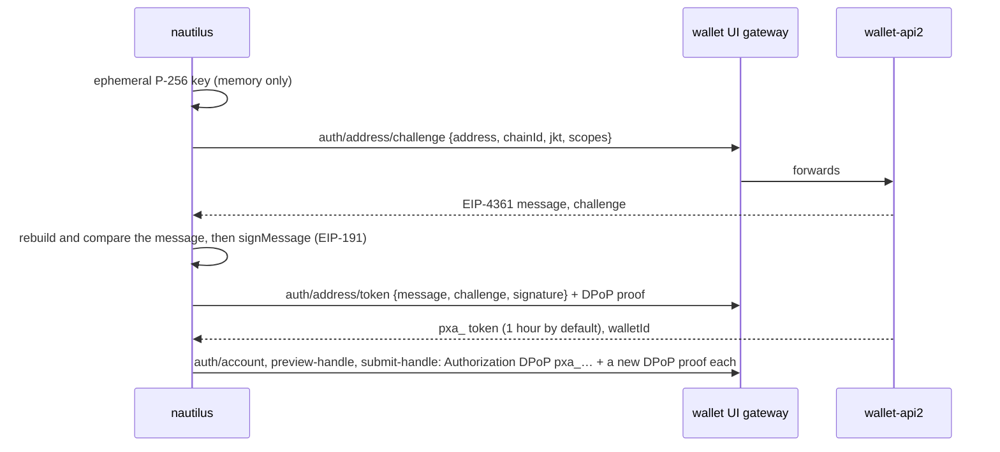

# Sign in from scripts and CI

On a node with the native SSI module, nautilus presents credentials from walt.id
**wallet-api2** ([credential-gated assets](/docs/guides/identity)). People log in to it with
Hanko (a passkey or an e-mail code), which a script, a backend or a CI job cannot do. Copying
a browser's session token into a pipeline works for at most 12 hours.

Instead, the script signs in with the key it already holds: the key of one of the
organisation's EVM addresses, the one that orders and pays. wallet-api2 answers a short-lived
token (`pxa_…`) that is bound to a key nautilus makes in memory, so a token that leaks from a
log or a proxy is useless on its own.

```ts twoslash
import { JsonRpcProvider, Wallet } from 'ethers'
import { Nautilus, WalletApi2CredentialProvider } from '@deltadao/nautilus'

const provider = new JsonRpcProvider('https://rpc.dev.pontus-x.eu')
const config = { oceanNodeUri: 'https://node.example.org' }
// ---cut---
const signer = new Wallet(process.env.PRIVATE_KEY as string, provider)

const credentials = WalletApi2CredentialProvider.withAddressSignIn({ // [!code focus]
  gateway: 'https://wallet.example.org/api/address-gateway', // [!code focus]
  signer // [!code focus]
}) // [!code focus]

const nautilus = await Nautilus.create(signer, { config, credentials })
const { url } = await nautilus.access({ assetDid: 'did:ope:1234abcd...' })
```

Anyone who holds the address's key can do what the admins allowed for it. Use one address per
pipeline and keep its key like any other production secret (an environment secret of the CI
system, or a KMS-backed signer).

## Before you start: what an admin sets up

Sign-in is off by default, at three levels. In the pontusx wallet UI:

| Step | Who | Where |
| --- | --- | --- |
| 1. Allow sign-in with addresses for the organisation | platform super admin | All organizations → "Allow sign-in with addresses for this organization" |
| 2. Link the address to the organisation, if it is not yet | organisation admin | Addresses → Add an address |
| 3. Turn on "Sign-in for scripts and servers" for the address, with the verifiers it may present to | organisation admin | Addresses → the address → Sign-in for scripts and servers |
| 4. Choose the organisation credentials it may present | organisation admin | the same panel ("Choose…"), or Credentials → "Addresses (scripts)" |
| 5. Optional: "Present as …" (the organisation's did:web) and "Sign asset descriptions (DDOs)" | organisation admin | the same panel |

A verifier is its exact `client_id` and the origin of its `response_uri`. For a pontusx-node
that is its verifier's `client_id` (`decentralized_identifier:did:jwk:…`) and
`https://<verifierPublicHost>`. The address starts without organisation credentials, also when
sign-in was on before: step 4 is needed every time it is turned on.

The deployment must run the address gateway (`ADDRESS_GATEWAY_ENABLED=true` in the wallet UI,
`addressSignIn.enabled` in wallet-api2). Its URL is the wallet UI's address plus
`/api/address-gateway`.

## Five minutes, step by step

1. Ask your organisation admin for steps 1 to 4 above, for the address your script signs with.
   Tell them the node you will consume from; they add its verifier.
2. Put the key and the gateway in the environment (see `example.env`):

   ```sh
   PRIVATE_KEY=0x...
   WALLET_GATEWAY=https://wallet.example.org/api/address-gateway
   ```

3. Check the setup before you run anything that orders:

   ```ts twoslash
   import { JsonRpcProvider, Wallet } from 'ethers'
   import { WalletApi2CredentialProvider } from '@deltadao/nautilus'

   const provider = new JsonRpcProvider('https://rpc.dev.pontus-x.eu')
   // ---cut---
   const signer = new Wallet(process.env.PRIVATE_KEY as string, provider)
   const credentials = WalletApi2CredentialProvider.withAddressSignIn({
     gateway: process.env.WALLET_GATEWAY as string,
     signer
   })

   const account = await credentials.signIn.check() // [!code focus]
   console.log(account.walletId, account.verifiers, account.presentableCredentials)
   ```

   `check()` signs in and reads `GET /auth/account`: the address's wallet, the verifiers it may
   present to, whether it may present as the organisation, and the credentials it may present
   (types and formats, no claim values). An empty `presentableCredentials` means step 4 is
   missing.

4. Pass `credentials` to `Nautilus.create` and call `access()`, `compute()` or
   `freeCompute()` as usual. Before it opens a session at the node, nautilus signs in (when it
   has to) and runs the same check once, so a missing verifier or credential fails before
   anything is ordered and leaves no pending session at the node.

## What happens



- **The message is checked before it is signed.** nautilus builds the message it expects from
  what it asked for (this gateway's host and URL, the address, the chain, the statement for
  the scopes, its own key's thumbprint) and compares it with the server's byte for byte. A
  difference is refused with `code: 'message_unexpected'`, naming the expected and the actual
  line. The usual cause is a wallet-api2 whose `ADDRESS_SIGN_IN_PUBLIC_URL` is not the URL you
  use (for example `localhost` against the public URL).
- **Tokens live in memory.** The token and the key are never written anywhere and never
  logged, at any `NAUTILUS_DEBUG` level. nautilus signs in again 60 seconds before the token
  expires, and after a `401` (a revoked or expired token) it signs in again and retries the
  request once. Concurrent requests share one sign-in.
- **The chain** is the signer's provider's network, or `chainId`.
- **Smart accounts.** wallet-api2 checks an ERC-1271 signature when the address was linked as
  a smart account. The account must be deployed: signatures of undeployed accounts (ERC-6492)
  are not supported. `smartAccount: true` makes nautilus refuse an address without code
  before it signs anything.

## Signing DDOs from the same sign-in

With "Sign asset descriptions (DDOs)" on for the address, sign in with the `sign-ddo` scope
and publish with a [`WalletApi2VcSigner`](/docs/api/signing/WalletApi2VcSigner). The scope is
named in the signed message, so the signer sees it.

```ts twoslash
import { JsonRpcProvider, Wallet } from 'ethers'
import {
  Nautilus,
  WalletApi2CredentialProvider,
  WalletApi2VcSigner
} from '@deltadao/nautilus'

const provider = new JsonRpcProvider('https://rpc.dev.pontus-x.eu')
const signer = new Wallet('0x...', provider)
const config = { oceanNodeUri: 'https://node.example.org' }
// ---cut---
const credentials = WalletApi2CredentialProvider.withAddressSignIn({
  gateway: 'https://wallet.example.org/api/address-gateway',
  signer,
  scopes: ['present', 'sign-ddo'] // [!code focus]
})

const ddoSigner = new WalletApi2VcSigner({ // [!code focus]
  signIn: credentials.signIn, // [!code focus]
  keyId: 'publisher-key', // [!code focus]
  issuer: 'did:web:example.org' // [!code focus]
}) // [!code focus]

const nautilus = await Nautilus.create(signer, { config, credentials, ddoSigner })
```

## In CI: parallel jobs

- **One address per pipeline.** Each address has its own verifiers, credentials, activity
  and emergency switch in the wallet UI. Sharing one key across unrelated pipelines makes
  them indistinguishable there.
- **One sign-in per process.** Create the provider once and reuse it for every call of the
  process; it renews its token itself. A new provider per call signs in every time.
- **Parallel jobs** with the same address each sign in on their own; that is fine. Each sign-in
  is a session: wallet-api2 allows 50 active sessions per address (`too_many_sessions` beyond),
  and at most 8 open previews per session and 16 per address. Call
  `credentials.signIn.signOut()` at the end of a job so its session does not count until it
  expires.
- **Shared egress IPs** are expected: the gateway counts failed sign-ins per IP (30 per
  minute), not successful ones. On `429 rate_limited`, `details.retryAfter` says how long to
  wait.
- **The node's own limit** stays: 5 pending SSI sessions per consumer address. Parallel jobs
  with one address should not start more than a few `access()` or `compute()` calls at a time.

## Local development against the e2e stack

pontusx-wallet-ui's local stack (`deploy/e2e/up.sh`) runs the gateway at
`https://wallet.pxw.test:8443/api/address-gateway` on chain `31338`, and its scenario
`11-address-sign-in` leaves sign-in on for anvil account 1
(`0x70997970C51812dc3A010C7d01b50e0d17dc79C8`) with one granted organisation credential. To
point a script at it:

- resolve `*.pxw.test` to `127.0.0.1` (an `/etc/hosts` entry for `wallet.pxw.test` and the
  node's host), and trust the stack's test CA: `NODE_EXTRA_CA_CERTS=<pontusx-wallet-ui>/deploy/.local-e2e/tls/ca.crt`;
- use the URL wallet-api2 has as `ADDRESS_SIGN_IN_PUBLIC_URL` exactly, port included; a
  different host or port is refused as `message_unexpected` before anything is signed;
- sign with anvil account 1's well-known test key and pass `chainId: 31338` if the signer's
  provider is not the stack's chain.

A plain `http://` gateway is accepted on `localhost`, `127.0.0.1` and `*.localhost` only; set
`allowInsecureTransport: true` for anything else.

## When it fails

Every refusal is a [`CredentialPresentationError`](/docs/api/identity/WalletApi2CredentialProvider#errors)
(or a `WaltIdWalletError` from `check()` and the DDO signer) with the server's code in
`details.code` (`error.code`), what to do in `details.hint`, and `reason`:

- `sign-in`: the address could not sign in, or its token was refused;
- `not-permitted`: the address may not do this, an admin changes its settings;
- `no-matching-credential`: the wallet holds nothing the request asks for; organisation
  credentials appear only if an admin put this address on their access list.

The [`AddressSignIn` reference](/docs/api/identity/AddressSignIn#errors) lists every code with
its cause and who fixes it. The wallet UI's "Recent activity" panel of the address shows the
same codes, so an admin can see a refusal without server logs.

:::warning
Never let the address key `personal_sign` text from anywhere else. A sign-in message for the
gateway, signed on behalf of a stranger, gives them a token for your organisation's wallet.
nautilus's legacy walt.id client signs only a one-line login nonce for this reason.
:::
